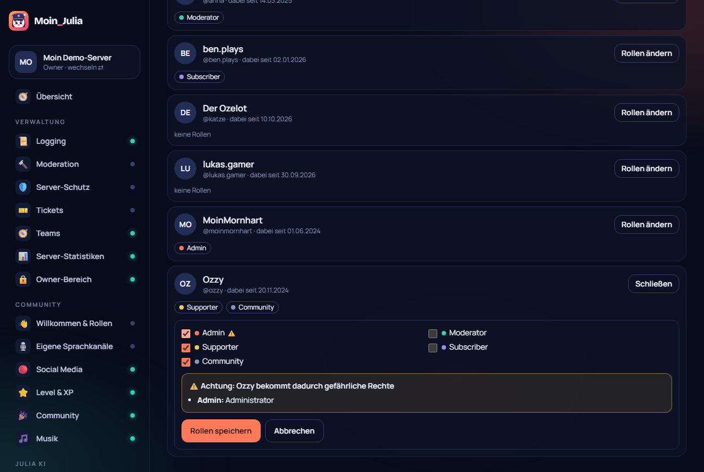

# 64 – Mitglieder verwalten (Issue #7 + #8)

**Datum:** 14.10.2026 · **Version:** 0.53.0 · **Status:** fertig und getestet

Wunsch aus Issue #7 („Rollen zuweisen mit Warnung, welche Rechte die Person bekommt“) und #8 („Mitglieder-Übersicht wie in Discord“).

## Neu: Seite „👥 Mitglieder“ (Werkzeuge)
- **Liste wie in Discord:** Bild, Anzeigename, @Benutzername, „dabei seit“ und die Rollen als farbige Chips. Bots stehen nicht in der Liste.
- **Suchen:** ab dem ersten Buchstaben, auch mitten im Namen und mit Tippfehlern (gleiche Suche wie überall im Dashboard).
- **Sortieren:** Name A–Z, Neueste zuerst oder Am längsten dabei.
- **Filtern:** nach Rolle.
- **Laden:** Es werden 50 Einträge angezeigt, „Mehr zeigen“ lädt weitere nach.
- **Rollen ändern** (Owner und Admins): Rollen an- oder abhaken, dann speichern.
  - **Warnung schon beim Ankreuzen:** zeigt, welche gefährlichen Rechte dazukommen (z. B. Administrator, Bannen, Rollen verwalten). Vor dem Speichern muss man noch einmal bestätigen.
  - **Gesperrte Rollen** sind ausgegraut und haben einen Grund dabei:
    - von Discord verwaltet (Bot, Booster),
    - über der Bot-Rolle,
    - über der eigenen höchsten Rolle.
  - Discords Audit-Log zeigt, wer im Dashboard geändert hat („Dashboard (Name)“).

## Entscheidungen (von Philip zu bestätigen)
- **Administrator-Rollen** vergibt nur der Server-Owner (bzw. Philip mit Generalschlüssel). Admins bekommen den Hinweis „nur der Server-Owner“.
- Admins dürfen wie in Discord nur Rollen **unter ihrer eigenen höchsten Rolle** ändern.

## Technik
- `packages/shared/src/config/member-roles.ts`:
  - `planRoleChange` rechnet aus, was hinzukommt und was wegfällt, was gesperrt ist und welche Warnungen es gibt;
  - `roleBlockReason` liefert den Grund für gesperrte Rollen.
- `apps/dashboard/src/lib/members.ts`:
  - Mitglieder mit Rollen, Beitritt und Avatar (60 s Zwischenspeicher);
  - Bot- und Personen-Hierarchie;
  - Rollen setzen per `PUT`/`DELETE`.
- Demo-Modus: Änderungen werden in Redis gemerkt.

## Wie getestet
| Test | Ergebnis |
|---|---|
| Hierarchie-Gründe, Hinzufügen/Entfernen, Warnung, Administrator nur Owner (Unit) | ✓ neu |
| Klick-Test: alle 6 Demo-Mitglieder, Suche „ozelto“, Admin ankreuzen → Warnung → bestätigen → nach Neuladen sichtbar → wieder entfernen | ✓ neu |
| Klick-Test 242/242, Seiten-Durchlauf 43 × 2, Unit shared 175 | ✓ |
