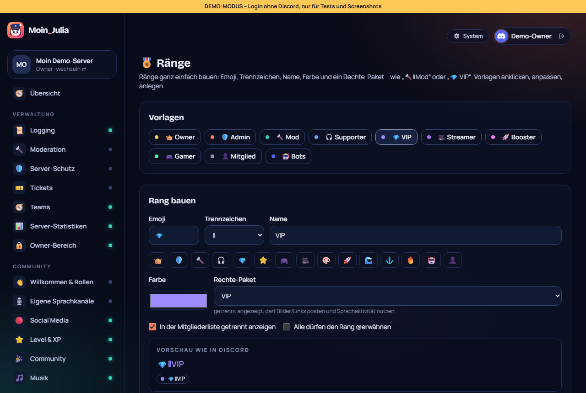

# 66 – Ränge-Baukasten (Issue #8)

**Datum:** 14.10.2026 · **Version:** 0.55.0 · **Status:** fertig und getestet

Wunsch von JONIMONI09: „Bitte einfacher machen mit Owner etc., man soll Ränge erstellen können wie im Bild, z. B. Namen und besondere Sachen.“

## Neu: Seite „🎖️ Ränge“ (Werkzeuge)
- **Vorlagen** zum Anklicken: 👑 Owner, 🛡️ Admin, 🔨 Mod, 🎧 Supporter, 💎 VIP, 🎥 Streamer, 🚀 Booster, 🎮 Gamer, 👤 Mitglied, 🤖 Bots.
- **Baukasten:**
  - Emoji, wahlweise aus 15 Schnell-Emojis;
  - Trennzeichen: ‖ ・ ┃ | » • - Leerzeichen oder ohne;
  - Name, Farbe;
  - Rechte-Paket;
  - Häkchen für „getrennt anzeigen“ und „@erwähnbar“.
- **Live-Vorschau** so, wie der Rang in Discord aussieht: farbiger Name und Rollen-Chip.

| Rechte-Paket | Was der Rang darf |
|---|---|
| Nur Deko | keine Rechte |
| Mitglied | keine Extra-Rechte |
| VIP | Dateien und Links posten, externe Emojis, Sprachaktivität |
| Supporter | Nachrichten löschen, Timeout, Stummschalten und Verschieben in Sprachkanälen; **kein** Bannen |
| Moderator | kicken, bannen, Timeout, Nachrichten löschen; keine Admin-Rechte |
| ⚠️ Administrator | alles |

- **Warnung** bei gefährlichen Rechten.
- **Administrator** legt nur der Server-Owner (bzw. Philip mit Generalschlüssel) an. Für alle anderen ist das Paket gesperrt. Die Vorlagen Owner und Admin werden für sie auf „Moderator“ gesetzt, mit Hinweis.
- **Vorhandene Ränge bearbeiten:**
  - Emoji und Trennzeichen werden aus dem Namen erkannt.
  - Standard ist „Rechte nicht ändern“, damit eigene Rechte erhalten bleiben.
  - Gesperrt sind Rollen über der Bot-Rolle oder über der eigenen höchsten Rolle sowie Bot- und Booster-Rollen. Der Grund steht jeweils dabei.
- Die Reihenfolge der Ränge sortiert der **Ränge-Fixer** (nächstes Modul).

## Wie getestet
| Test | Ergebnis |
|---|---|
| Namen bauen/zerlegen („🔨‖Mod“, „💎 VIP“, „🛡️・Admin“), Rechte-Pakete (Supporter ohne Bannen, nur Admin mit Administrator) | ✓ neu |
| Klick-Test: Vorlage → Vorschau → Trennzeichen/Name ändern → anlegen; „Supporter“ bearbeiten → Emoji dazu → gespeichert | ✓ neu |
| Klick-Test 248/248, Seiten-Durchlauf 43 × 2, Unit shared 180 | ✓ |
