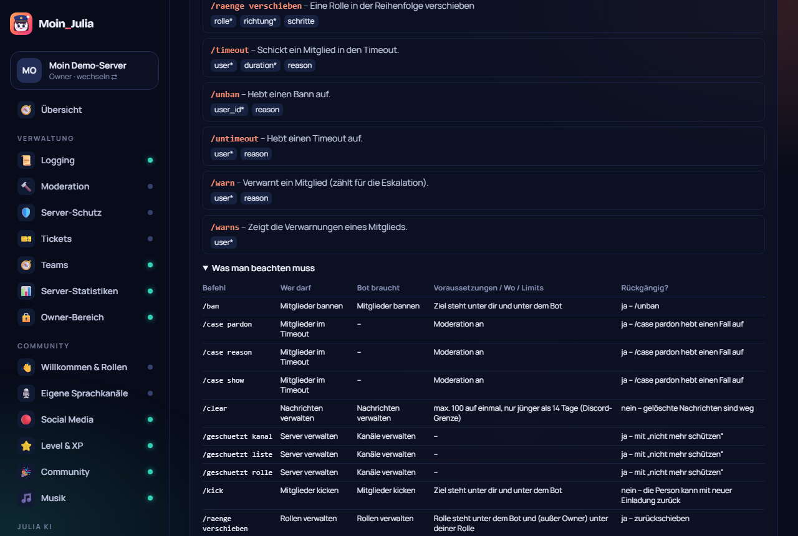

# 71 – Befehls-Übersicht (Wunsch Philip)

**Datum:** 14.10.2026 · **Version:** 0.59.0 · **Status:** fertig und getestet

Wünsche: „Im Dashboard vom Server eine Stelle, wo alle Commands drinstehen“ und „eine Tabelle dazu, was man beachten muss“.

## Jetzt
- Neue Seite **„📖 Befehle“** (Werkzeuge) mit **allen 66 Befehlen**:
  - nach Modul sortiert,
  - mit Beschreibung und Optionen (Pflicht-Optionen mit *),
  - mit Hinweis, ob das Modul auf diesem Server an ist.
- **Suche** filtert nach Name, Beschreibung und Optionen.
- **Pro Modul eine Tabelle „Was man beachten muss“** (aufklappbar):

  | Spalte | Inhalt |
  |---|---|
  | Wer darf | Standard-Recht in Discord |
  | Bot braucht | Rechte, die der Bot dafür selbst haben muss |
  | Voraussetzungen / Wo / Limits | z. B. „Ziel steht unter dir und unter dem Bot“, „max. 100, nur jünger als 14 Tage“, „du bist im Sprachkanal“ |
  | Rückgängig? | z. B. „ja – /unban“ oder „nein – gelöschte Nachrichten sind weg“ |

- **„💬 Mit Julia reden“:** alle „@Julia …“-Sätze mit Beispiel, Wirkung und wer darf (Dashboard-Fragen, Einstellungen ändern, Werkzeuge, Herrscher).
- **Nie veraltet:** Die Liste wird aus den echten Befehls-Definitionen des Bots erzeugt (`packages/shared/src/commands.catalog.ts`). Ein Test schlägt fehl, sobald sich ein Befehl ändert und die Liste nicht neu erzeugt wurde: `UPDATE_CATALOG=1 pnpm --filter @moin/bot exec vitest run src/core/command-catalog.test.ts`. Die Hinweise stehen in `config/command-notes.ts`; der längste passende Name gewinnt („musik play“ vor „musik“).

## Wie getestet
| Test | Ergebnis |
|---|---|
| Katalog aktuell, Unterbefehle aufgelöst; Hinweise (längster Name), Rechte lesbar | ✓ neu |
| Klick-Test: Module sichtbar, Suche „timeout“ filtert, Tabelle mit „höchstens 28 Tage“, Julia-Sätze | ✓ neu |
| Klick-Test 256/256, Seiten-Durchlauf 43 × 2, Unit shared 191, Bot 307 | ✓ |
