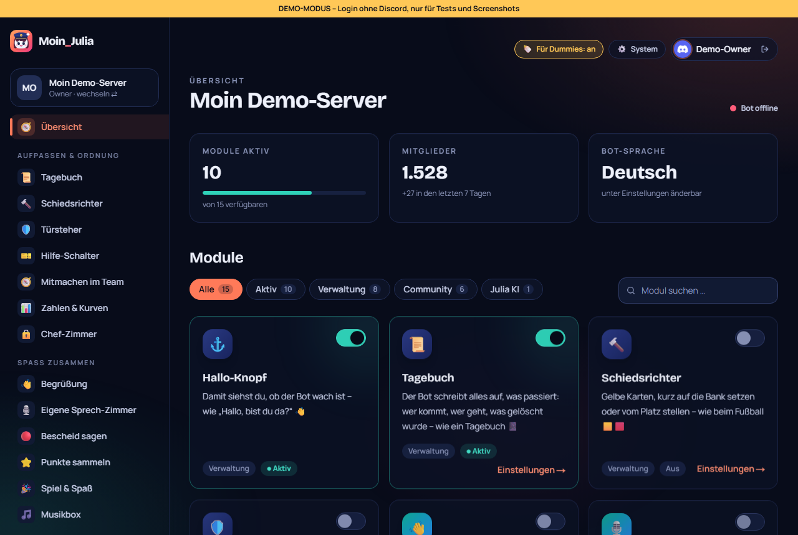

# 77 – Dashboard „🍼 Für Dummies“ (Wunsch Philip)

**Datum:** 14.10.2026 · **Version:** 0.64.0 · **Status:** fertig und getestet

Wunsch: „Pack die Sprache ‚Für Dummies' aufs Dashboard.“

## Jetzt
- **🍼-Knopf oben rechts** (neben „System“): ein Klick schaltet das Dashboard auf „Für Dummies“, noch ein Klick wieder zurück.
  - Die Einstellung gilt pro Person bzw. Browser und wird ein Jahr lang gemerkt (Cookie).
  - Die Bot-Sprache auf dem Server ändert sich dadurch **nicht**. Die stellt man weiterhin unter Einstellungen → Sprache um.
- **Umgestellt werden:**
  - **Modulnamen** in Menü, Übersicht und Modulseiten:

    | Normal | Für Dummies |
    |---|---|
    | Logging | Tagebuch |
    | Moderation | Schiedsrichter |
    | Server-Schutz | Türsteher |
    | Tickets | Hilfe-Schalter |
    | Teams | Mitmachen im Team |
    | Statistiken | Zahlen & Kurven |
    | Owner-Bereich | Chef-Zimmer |
    | Musik | Musikbox |
    | Level & XP | Punkte sammeln |
    | Social Media | Bescheid sagen |

  - **Beschreibungen**, z. B. „Gelbe Karten, kurz auf die Bank setzen oder vom Platz stellen – wie beim Fußball 🟨🟥“.
  - **Menü-Bereiche:** „Aufpassen & Ordnung“, „Spaß zusammen“, „Werkzeugkiste 🧰“.
- Alles andere (Einstellungsfelder, Meldungen) bleibt vorerst normal. Weitere Texte kommen nach und nach dazu (Idee notiert).

## Wie getestet
| Test | Ergebnis |
|---|---|
| Jedes Modul hat einfachen Namen + Erklärung; aus = normal, an = einfach | ✓ neu |
| Klick-Test: 🍼 an → „Schiedsrichter“ + „Werkzeugkiste“ im Menü → aus → „Moderation“ | ✓ neu |
| Klick-Test 263/263, Seiten-Durchlauf 43 × 2, Unit shared 201 | ✓ |
