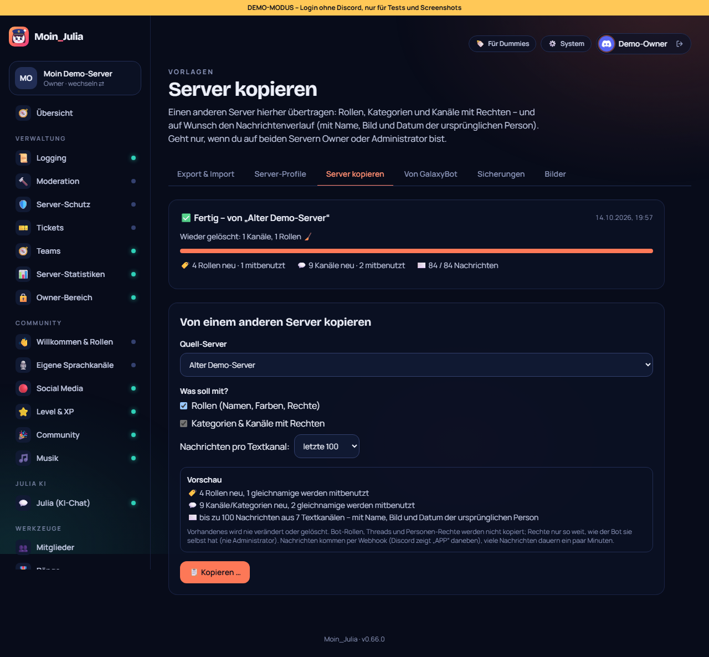

# 81 – Server kopieren (mit Nachrichtenverlauf)

**Wunsch Philip (14.10.2026):** Einen Discord-Server auf einen anderen übertragen, und zwar „gleich die Nachrichten mitkopieren, wie es ist, quasi im Verlauf“.

## So geht es
Im Dashboard des **Ziel-Servers**: **Vorlagen → Server kopieren**.

1. **Quell-Server wählen.** Angezeigt werden nur Server, auf denen der Bot ist und auf denen du Owner oder Administrator bist.
2. **Auswählen, was mitkommt:**
   - Rollen (Name, Farbe, Anzeige, erwähnbar, Rechte).
   - Kategorien und Kanäle mit Rechten (Thema, Altersbeschränkung, Slowmode, Personenlimit, Bitrate).
   - Nachrichten pro Textkanal: keine, 50, 100, 500 oder 1000.
3. **Die Vorschau zeigt:**
   - wie viel neu angelegt wird;
   - wie viel mitbenutzt wird (Gleichnamiges wird nie verändert oder gelöscht);
   - aus wie vielen Kanälen Nachrichten kommen.
4. **„📋 Kopieren …“ → „Ja, kopieren“.** Ab dann arbeitet der Bot im Hintergrund. Die Seite zeigt den Fortschritt (alle 2 s), und man kann abbrechen.
5. **„🧹 Angelegtes wieder löschen“** entfernt alles, was die Kopie neu angelegt hat: erst Kanäle, dann Rollen.

## Die Nachrichten
- Der Bot liest die Nachrichten im Quell-Kanal von alt nach neu und schreibt sie per Webhook in den neuen Kanal.
- **Name und Profilbild** sind die der ursprünglichen Person. Discord zeigt daneben „APP“.
- **Original-Datum:** Discord kann kein altes Datum setzen. Deshalb steht über jeder Nachricht eine kleine Zeile „📅 03.10.2026, 14:22“, bei bearbeiteten Nachrichten mit „(bearbeitet)“.
- **Anhänge:**
  - Bilder und Dateien bis 10 MB werden neu hochgeladen, größere kommen als Link.
  - Embeds werden mitkopiert.
  - Sticker erscheinen als Text.
- **Erwähnungen** pingen niemanden (`allowedMentions: none`).
- **Nicht kopiert:** System-Nachrichten (z. B. „X ist beigetreten“), Threads und Reaktionen.
- **Dauer:** Discord bremst Webhooks, darum dauern viele Nachrichten ein paar Minuten. Der Bot wartet von selbst.

## Sicherheit und Rechte
- **Wer darf:** Nur wer auf **beiden** Servern Owner oder Administrator ist.
  - Der Bot prüft das beim Start noch einmal live.
  - Der Generalschlüssel des Instanz-Admins reicht dafür **nicht**, sonst könnte man ohne Zustimmung Nachrichten fremder Server übertragen.
- **Rechte nur so weit, wie der Bot sie selbst hat, nie Administrator.**
  - Personen-Rechte an Kanälen werden weggelassen, weil die Leute auf dem anderen Server andere sind.
  - Bot-/Integrations-Rollen und @everyone werden nicht kopiert.
- **Der Bot gibt sich in jedem neuen Kanal selbst Zugriff** (sehen, schreiben, Webhooks), sonst könnte er danach nichts mehr verwalten.
- **Transparenz:** Beide Server bekommen einen Hinweis im Log-Kanal: wer kopiert hat, von wo nach wo und wie viel.
- **Ohne Community-Funktion** werden Ankündigungs- und Forum-Kanäle zu Text-Kanälen, Bühnen zu Sprachkanälen.

## Technik
- **Planung und Regeln:** `packages/shared/src/config/server-copy.ts`. Das umfasst Rollen-Reihenfolge, Rechte maskieren, Rechte umschreiben, Kanaltypen, Webhook-Namen und Datumszeile, plus Tests.
- **Ausführung im Bot:** `apps/bot/src/modules/kern/server-copy.ts`.
  - Auftrag über Redis `moin:copy:job:<Ziel>` und `module-action` (`copy-start`, `copy-undo`).
  - Fortschritt landet in Redis.
- **Dashboard:**
  - Seite: `vorlagen/kopieren`.
  - Komponente: `ServerCopy`.
  - Demo: ausgedachter Quell-Server, die Kopie ist sofort fertig.

## Entscheidungen (von Philip zu bestätigen)
- **Höchstens 1000 Nachrichten pro Kanal.** Das ist gegen stundenlange Läufe gedacht; mehr geht, wenn gewünscht.
- **Nachrichten per Webhook** mit Original-Name und -Bild, wie bei üblichen Umzugs-Bots. Die Alternative wäre „alles vom Bot“ mit Namen im Text.

## Tests
- **Unit:** Rechte, Rollenplan, Rechte umschreiben, Kanaltypen, Webhook-Namen, Datumszeile, 2000-Zeichen-Grenze.
- **Klick-Test 268/268:** Vorschau, Kopie fertig, Angelegtes wieder löschen.
- **Sweep:** 44 Seiten × 2.
- **Von Philip zu testen:** eine echte Kopie zwischen zwei eigenen Servern.
