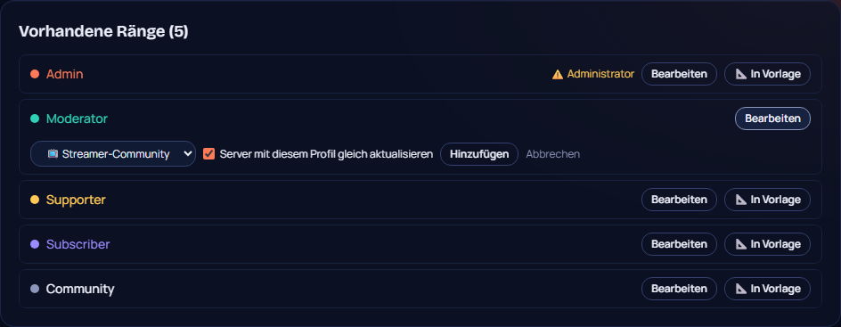

# 82 – Ränge in Vorlagen, Server danach aktualisieren

**Wunsch Philip (14.10.2026):** Er will im Dashboard Ränge bearbeiten und sie zu den Vorlagen hinzufügen. Server, die diese Vorlage nutzen, sollen danach entsprechend aktualisiert werden.

## So geht es
- **Ränge → „📐 In Vorlage“** bei jedem Rang. Dort Vorlage wählen (z. B. „📺 Streamer-Community“) → „Hinzufügen“.
  - Übernommen werden Name, Farbe, Rechte, „getrennt anzeigen“ und „erwähnbar“. **Administrator wird nie übernommen.**
  - Den Haken „Server mit diesem Profil gleich aktualisieren“ gibt es schon beim Hinzufügen; er ist ab Werk an. Dann legt der Bot den Rang auf allen Servern an, auf denen dieses Profil aktiv ist.
  - Gibt es den Rang in der Vorlage schon (gleicher Name), wird er mit dem aktuellen Stand überschrieben. So lässt sich ein Rang ändern und neu übernehmen.
- **Vorlagen → Server-Profile:**
  - Eigene Ränge stehen in der Rollen-Liste der Vorlage als „🎖️ eigener Rang“, mit „entfernen“.
  - „🔄 Alle Server mit diesem Profil aktualisieren“ gibt es pro Vorlage.
  - **Aktives Profil → „🔄 Profil aktualisieren“** gleicht nur diesen Server an.
- **Neu angewendete Profile** bringen die eigenen Ränge gleich mit (Vorschau, Anwenden).

## Was „aktualisieren“ macht
- Fehlende Rollen der Vorlage werden angelegt und als „vom Profil angelegt“ gemerkt. Beim Deaktivieren werden sie mit aufgeräumt.
- Eigene Ränge, die das Profil angelegt hat, bekommen geänderte Farbe, Rechte und Anzeige.
- **Nie verändert:** Rollen, die es vorher schon gab, also nicht vom Profil angelegt.
- **Nie gelöscht:** Nimmt man einen Rang aus der Vorlage, bleiben die Rollen auf den Servern bestehen.

## Rechte (Entscheidung, von Philip zu bestätigen)
- **Vorlagen ändern** (Rang hinzufügen/entfernen, alle Server aktualisieren) darf nur der **Instanz-Admin**. Die Vorlagen gelten für alle Server der Instanz, ein Server-Admin soll nicht die Vorlagen anderer Server verändern.
- **„Profil aktualisieren“ für den eigenen Server** dürfen Owner und Admins.

## Technik
- **Neue Tabelle:** `BlueprintRank` (Migration `20261014200000_blueprint_ranks`).
- **Shared:** `withExtraRanks`, `blueprintRoleBody`, `roleNeedsUpdate` in `server-blueprints.ts`.
- **Dashboard:** `lib/blueprint-ranks.ts` (`effectiveBlueprint`, `syncProfileRoles`, `syncBlueprintEverywhere`). Profile anwenden und analysieren nutzen jetzt die Vorlage inklusive eigener Ränge.

## Tests
- **Unit:** eigene Ränge werden angehängt (ohne Administrator, gleichnamige Bauplan-Rolle gewinnt).
- **Klick-Test 271/271:** Rang in Vorlage, steht in der Vorlage, wieder entfernen.
- **Sweep:** 44 Seiten × 2.
- **Von Philip zu testen:** Aktualisieren auf einem echten Server mit aktivem Profil.
