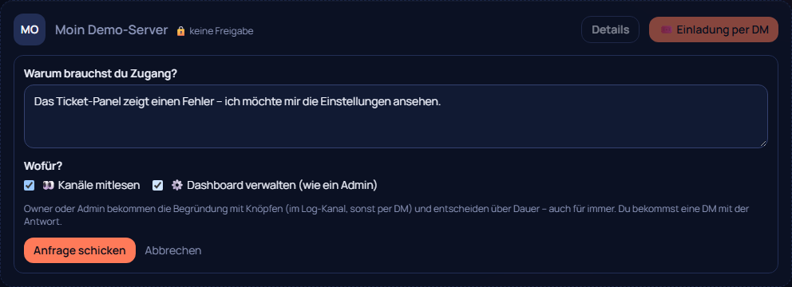
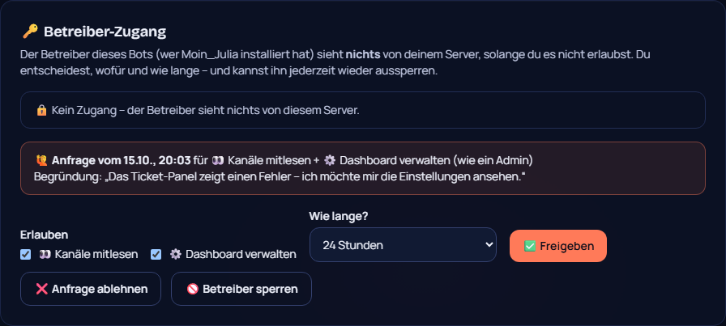

# 86 – Betreiber-Zugang nur mit Zustimmung (Issue #13)

**Wunsch JONIMONI09 (14.10.2026, Issue #13):**
- „Der Owner soll NIEMALS den Server fernsteuern, das wäre eine große Sicherheitslücke. Nur wenn der Discord-Owner es erlaubt.“
- Anfrage mit Begründung, Nachricht im Log-Kanal oder per DM mit Knopf, Umfang und Dauer wählbar (auch für immer).
- Im Dashboard soll man sehen, dass Zugriff erteilt wurde. Ohne Genehmigung soll alles ausgegraut sein.
- Der Owner soll den Betreiber sperren können.
- Popup für den Instanz-Admin bei kritischen Updates.

## Was sich ändert (0.69.0)
- **Der Generalschlüssel ist weg.**
  - Vorher bekam der Instanz-Admin mit `/moin zugang an` auf **jedem** Server Owner-Rechte im Dashboard, ohne zu fragen.
  - Den Befehl gibt es nicht mehr.
- **Ohne Freigabe sieht der Betreiber nichts.**
  - Server-Auswahl: Server ohne Freigabe stehen nur ausgegraut mit Namen da („🔒 Ohne Freigabe“).
  - System → Alle Server: Details, Einladung per DM und Mitlesen sind gesperrt. Der Server lädt auch nichts.
- **Zugang anfragen** (System → Alle Server → „🙋 Zugang anfragen …“):
  - Begründung ist Pflicht (mindestens 10 Zeichen, keine Pings).
  - Umfang: „👀 Kanäle mitlesen“ und/oder „⚙️ Dashboard verwalten (wie ein Admin)“.
  - Höchstens eine Anfrage alle 6 Stunden pro Server.
- **Die Nachricht an den Server**
  - geht in den Log-Kanal; gibt es keinen, per DM an den Owner;
  - zeigt die Begründung;
  - hat die Knöpfe ✅ 1 Stunde / 24 Stunden / 7 Tage / für immer, ❌ Ablehnen und 🚫 Betreiber sperren.
  - Entscheiden dürfen nur Owner und Administratoren.
  - Der Betreiber bekommt die Antwort per DM.
- **Verwalten:**
  - **Einstellungen → 🔑 Betreiber-Zugang:** Status, offene Anfrage mit Begründung, selbst freigeben (Umfang + Dauer), entziehen, ablehnen, sperren und entsperren.
  - **Befehl:** `/moin support-zugang dauer:… umfang:…`, mit den neuen Optionen „sperren“ und „entsperren“.
- **Sichtbar:** Solange Zugang besteht, zeigt **jede** Dashboard-Seite oben „🔑 Der Bot-Betreiber hat Zugang …“, mit Umfang, Dauer, wer erlaubt hat und Begründung.
- **„Dashboard verwalten“** gibt die Stufe **Admin**, nie Owner-Bereich, nie Owner-Rechte. Rollen vergeben geht damit nur, wenn der Betreiber auf dem Server selbst die nötigen Discord-Rechte hat.
- **Popup bei kritischen Updates:**
  - Ein Changelog-Eintrag kann `critical` haben.
  - Der Instanz-Admin bekommt nach dem Update einmal ein Popup mit dem Text („Verstanden“ merkt es sich im Browser).
  - 0.69.0 selbst ist so markiert.

## Entscheidungen (von Philip bestätigt, 17.10.: „lassen wir mal so“)
- **Gilt auch für Philips eigene Instanz.**
  - Auf Servern, die nicht ihm gehören, braucht er jetzt eine Freigabe. JONIMONI09 schreibt dazu: „MoinI darf auf meinen“, also einmal „für immer“ freigeben.
  - Auf eigenen Servern ist er Owner und braucht nichts.
- **Eine Anfrage erzeugt genau eine Nachricht.** Einzelne Zugriffe werden nicht gemeldet; das war Philips Wunsch „nervt“ aus 0.68.1.

## Technik
- **Shared:** `support.ts` mit Umfang (`scopes`), Begründung, Anfrage (`moin:support:request:<g>`), Sperre (`moin:support:block:<g>`) und Prüfungen; `changelog.ts` mit `critical`, `compareVersions` und `criticalSince`.
- **Bot:** `kern/operator-access.ts` (Anfrage zustellen, Knöpfe auch in der DM); `/moin zugang` entfernt; `/moin support-zugang` mit Umfang, Sperren und Entsperren.
- **Dashboard:**
  - `lib/access.ts`: `hasOperatorAccess` statt `hasMasterKey`, Freigabe pro Server.
  - Server-Auswahl ausgegraut.
  - `system/server` mit Anfrage.
  - `OperatorAccess` in den Einstellungen.
  - Banner im Layout.
  - Popup im `VersionFooter`.

## Tests
- **Unit:**
  - Umfang, Ablauf, Begründung.
  - `/moin zugang` gibt es nicht mehr.
  - Knöpfe: Nicht-Admin abgelehnt, Owner gibt frei (Umfang + Begründung + DM), Admin sperrt.
  - Popup-Auswahl.
- **Ergebnisse:** shared 230, bot 315.
- **Klick-Test 275/275:**
  - gesperrt → anfragen → in den Einstellungen freigeben → Banner → Details und Einladung → entziehen → Banner weg.
  - Außerdem einen wackeligen Logging-Test repariert: Er wartete auf ein „Gespeichert“, das noch vom vorigen Speichern dastand.
- **Sweep:** 44 Seiten × 2.
