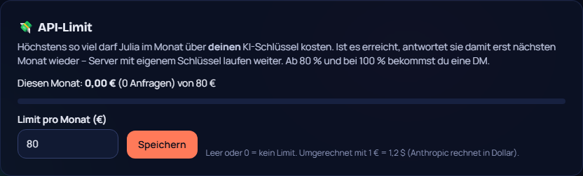

# 88 – API-Kostenlimit (z. B. 80 € im Monat)

**Wunsch Philip (15.10.2026):** Er will ein Limit für die API festsetzen können, zum Beispiel 80 Euro.

## So geht es
- **Einstellen:** Dashboard → **System → 💸 API-Limit**. Betrag in Euro pro Monat eintragen und speichern. Leer oder 0 heißt kein Limit.
- **Anzeige:** Die Karte zeigt den Verbrauch dieses Monats (Euro und Anzahl Anfragen) mit Balken: grün, ab 80 % gelb, bei 100 % rot.
- **Was zählt:** nur Anfragen über **deinen** KI-Schlüssel, den der Instanz. Server mit eigenem Anthropic-Schlüssel zahlen selbst und laufen weiter. Gemini, OpenAI und Ollama kosten die Instanz nichts.
  - Gezählt werden Antworten im Chat, `/julia frage` und `/julia sprich`, Julia im Call und die Vorschau im Dashboard.
- **Ist das Limit erreicht:**
  - Julia antwortet mit diesem Schlüssel bis zum Monatsende nicht mehr. Sie sagt „Mein Budget für diesen Monat ist aufgebraucht“; im Chat ohne Erwähnung bleibt sie still.
  - Die Vorschau im Dashboard sagt „API-Limit erreicht“.
- **DM an den Instanz-Admin:** einmal bei 80 % und einmal bei 100 %.
- **Zusätzlich gilt weiter das Monatsbudget pro Server** (Julia → Einstellungen, in Dollar).

## Umrechnung (von Philip bestätigt, 17.10.: „ich zahle ja Dollar“)
- Anthropic rechnet in US-Dollar ab. Umgerechnet wird mit dem festen Kurs **1 € = 1,20 $**. Das ist absichtlich etwas hoch angesetzt, damit das Limit eher zu früh als zu spät greift. Bei 80 € ist also bei 96 $ Schluss.
- **Die Zählung beginnt mit diesem Update.** Was vorher in diesem Monat verbraucht wurde, ist nicht enthalten.

**Seit 0.70.1:** Die Karte zeigt den Verbrauch und das Limit zusätzlich in Dollar, zum Beispiel „80 € (≈ 96,00 $ – so rechnet Anthropic ab)“.

## Technik
- **Shared:** `config/api-limit.ts` mit `parseApiLimitEur`, `apiLimitReached`, `apiLimitPercent`, `eurText` und dem Kurs.
- **Datenbank:** Einstellung `apiLimitEur`; neue Tabelle `InstanceUsage` pro Monat (Migration `20261015200000_instance_usage`).
- **Bot:** `complete()` in `julia/index.ts` prüft vor der Anfrage und bucht danach, nur beim Instanz-Schlüssel.
- **Dashboard:** `ApiLimitCard`; die Vorschau (`lib/julia.ts`) prüft und bucht ebenfalls.

## Tests
- **Unit:** Eingabe (Komma/Punkt/leer), Grenze in Dollar, Prozent, Anzeige in Euro. Ergebnisse: shared 233, bot 315.
- **Klick-Test 277/277:** 80 € setzen, nach Neuladen sichtbar, wieder entfernen.
- **Sweep:** ohne Probleme.
