# Bauprotokoll – Zeitstrahl

Jede Phase und jedes Modul bekommt eine eigene Datei. Die Dashboard-Screenshots werden nach jedem Modul neu aufgenommen, sodass sich der Fortschritt vergleichen lässt.

| Phase | Datum | Kurzbeschreibung | Vorschau | Link |
|---|---|---|---|---|
| 1 – Recherche | 08.10.2026 | Marktvergleich, API-Stand, Funktionsliste Muss/Soll/Später | – | [01-recherche.md](01-recherche.md) |
| 2 – Grundgerüst | 08.10.2026 | Monorepo, Bot mit Modul-System und `/ping`, Dashboard mit Discord-Login, Docker, Proxmox-Installer, Update mit Rollback | 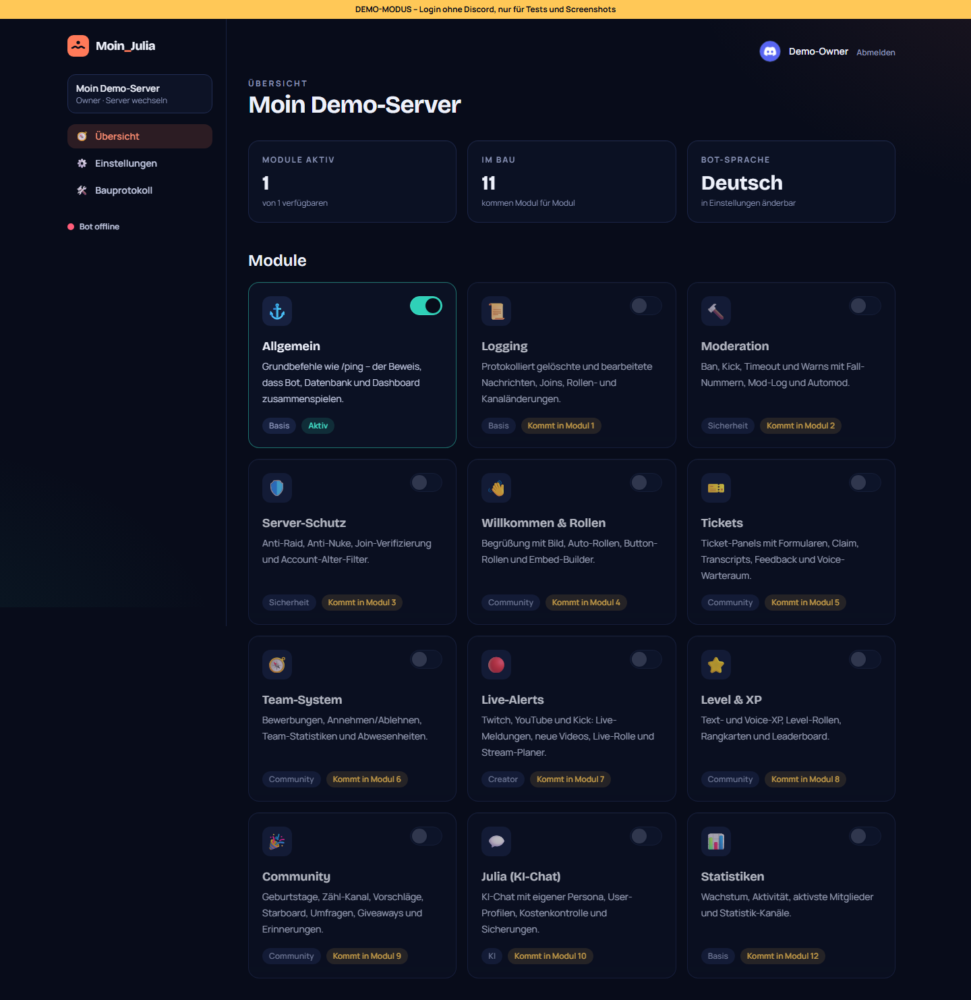 | [02-grundgeruest.md](02-grundgeruest.md) |
| Modul 1 – Logging | 08.10.2026 | 8 Kategorien (Nachrichten, Joins, Rollen, Bans, Kanäle, Rollen, Voice, Server), Kanal pro Kategorie, Audit-Log-Moderator, Einstellungsseite | 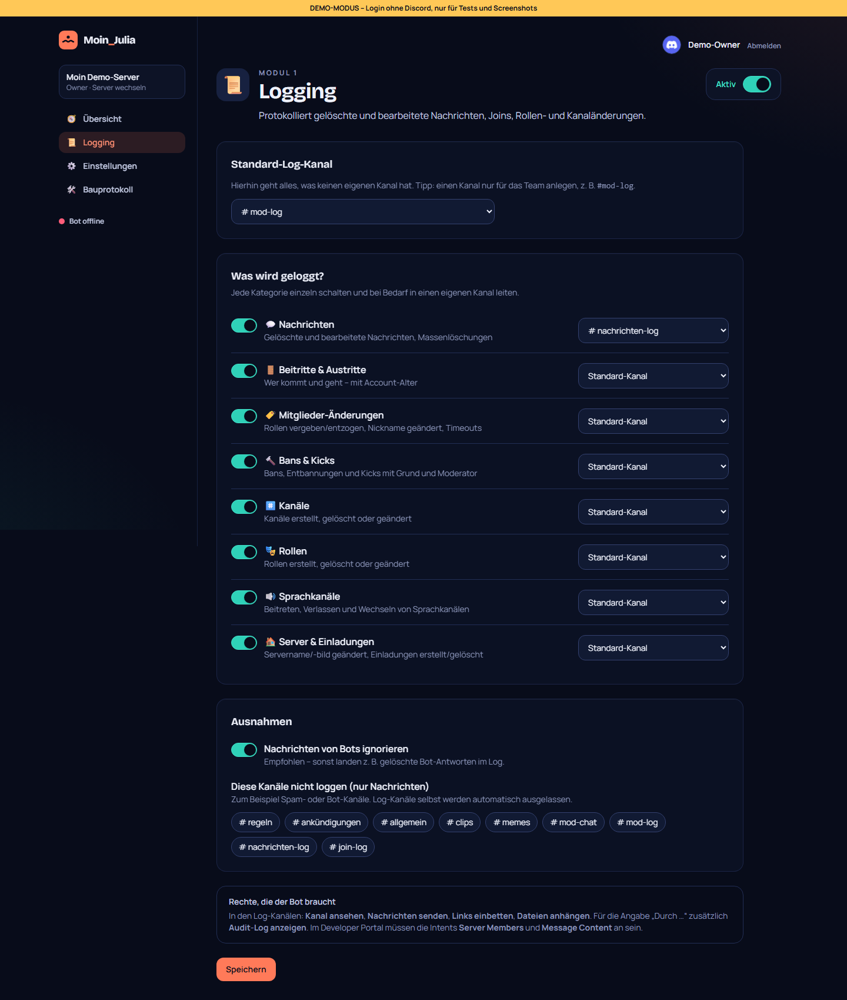 | [03-logging.md](03-logging.md) |
| Modul 2 – Moderation | 08.10.2026 | /warn /timeout /kick /ban /unban /warns /case /clear, Fall-Nummern, Mod-Log, Warn-Eskalation, Automod (Discord-Regeln + Spam/Caps), Fall-Liste | 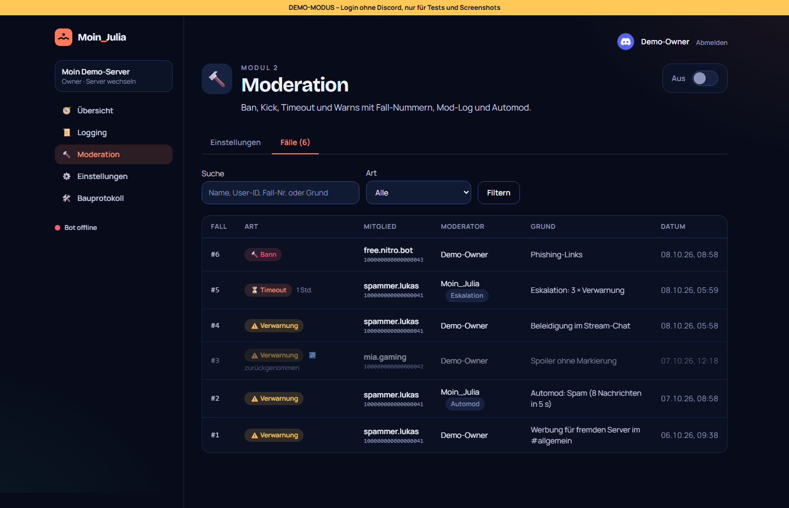 | [04-moderation.md](04-moderation.md) |
| Einrichtung über die Webseite | 08.10.2026 | Installer ohne Token-Fragen, Einrichtungs-Assistent mit Code und Live-Prüfung, verschlüsselte Ablage, System-Seite, Bot-Einrichtungsmodus | 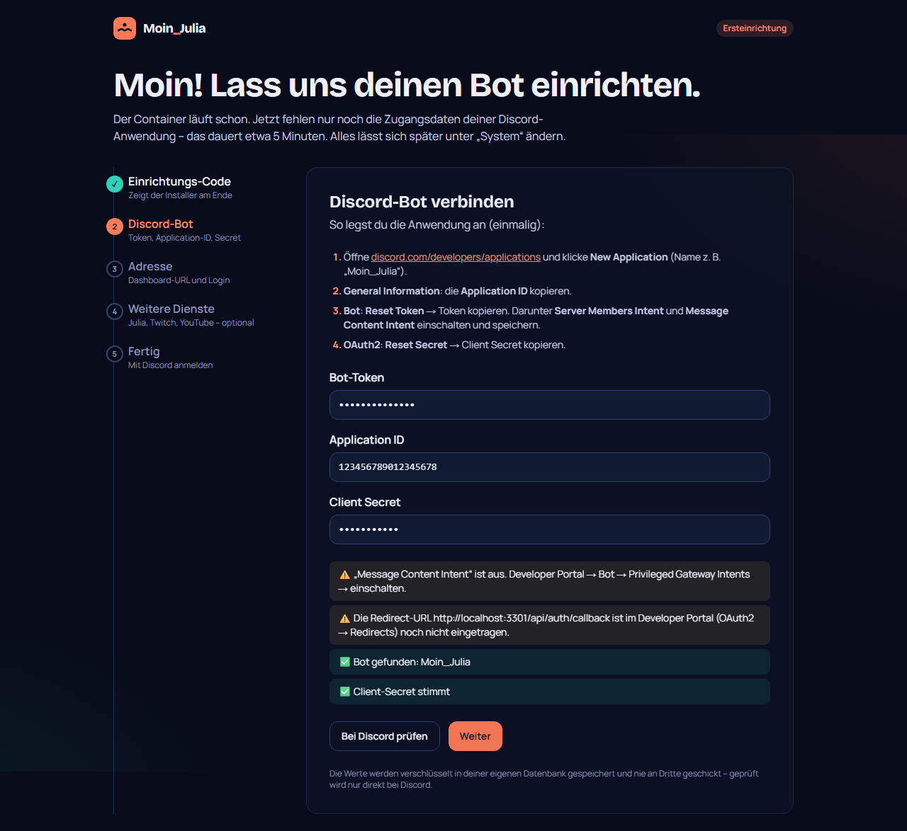 | [05-einrichtung.md](05-einrichtung.md) |
| Modul 3 – Server-Schutz | 08.10.2026 | Anti-Raid (Einladungen pausieren), Anti-Nuke über Audit-Log, Verifizierung mit Button/Captcha, Account-Alter-Filter | 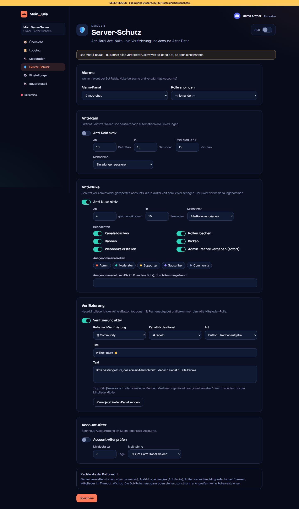 | [06-schutz.md](06-schutz.md) |
| Modul 4 – Willkommen & Rollen | 08.10.2026 | Embed-Builder mit Live-Vorschau, Willkommensbild (4 Stile), Abschied, DM, Auto-Rollen, Rollen-Panels (Buttons/Menü) |  | [07-willkommen.md](07-willkommen.md) |
| Vorlagen | 08.10.2026 | Einstellungen exportieren/importieren (Datei oder anderer Server) mit Kanal-/Rollen-Zuordnung, automatische Sicherungen, GalaxyBot-Übernahme | 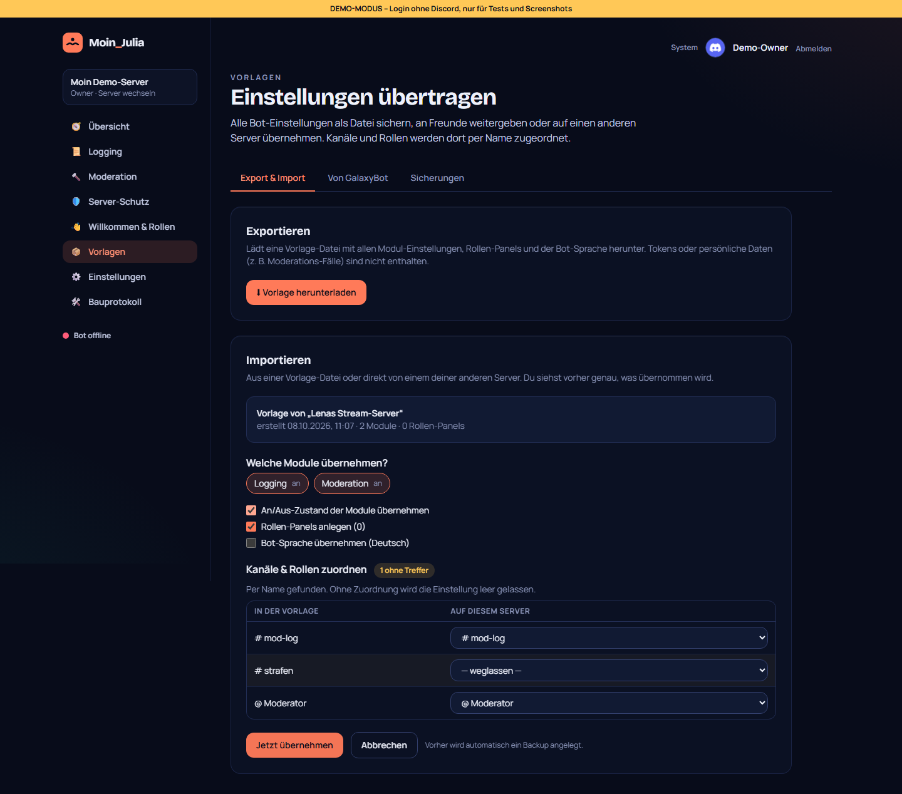 | [08-vorlagen.md](08-vorlagen.md) |
| Nachtrag 0.8.1 | 08.10.2026 | Bot-Erkennung direkt über Discord, Rückleitung nach dem Einladen, Bot meldet immer seinen Zustand mit Grund | – | [05-einrichtung.md](05-einrichtung.md#nachtrag-v081--bot-erkennung-und-einladen-rückmeldung-von-philip) |
| Nachtrag 0.8.2 – Bilder | 08.10.2026 | Bilder vom PC hochladen (Embeds, Willkommensbild-Hintergrund), in der DB gespeichert, Bot sendet sie als Anhang, Verwaltung unter Vorlagen → Bilder | 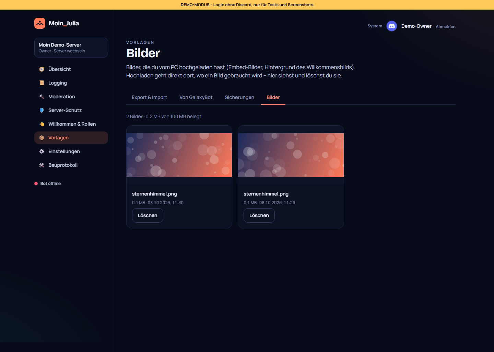 | [08-vorlagen.md](08-vorlagen.md#nachtrag-v082--bilder-vom-pc-hochladen-wunsch-von-philip) |
| Nachtrag 0.8.3 – Update-Fix | 08.10.2026 | Rollback leert das Schema vor dem Zurückspielen, Migrationen idempotent, Healthcheck unabhängig von Discord, OpenSSL im Image | – | [02-grundgeruest.md](02-grundgeruest.md#nachtrag-v083--update-hing-in-der-rollback-schleife-rückmeldung-von-philip) |
| Nachtrag 0.8.4 – Update-Knopf | 08.10.2026 | Version unten mit Update-Prüfung, System → Update mit Live-Protokoll (Host-Dienst über systemd), Intents-Fehler eindeutig | 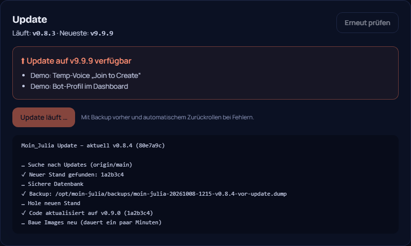 | [02-grundgeruest.md](02-grundgeruest.md#nachtrag-v084--version-unten-und-update-knopf-wunsch-von-philip) |
| Neuer Look 0.9.0 | 08.10.2026 | Maskottchen Kapitänin Julia, Seitenleiste nach Bereichen, Übersicht mit Filter/Suche, Animationen, Anmelde-Übergang, Versionsleiste mit Änderungsverlauf | 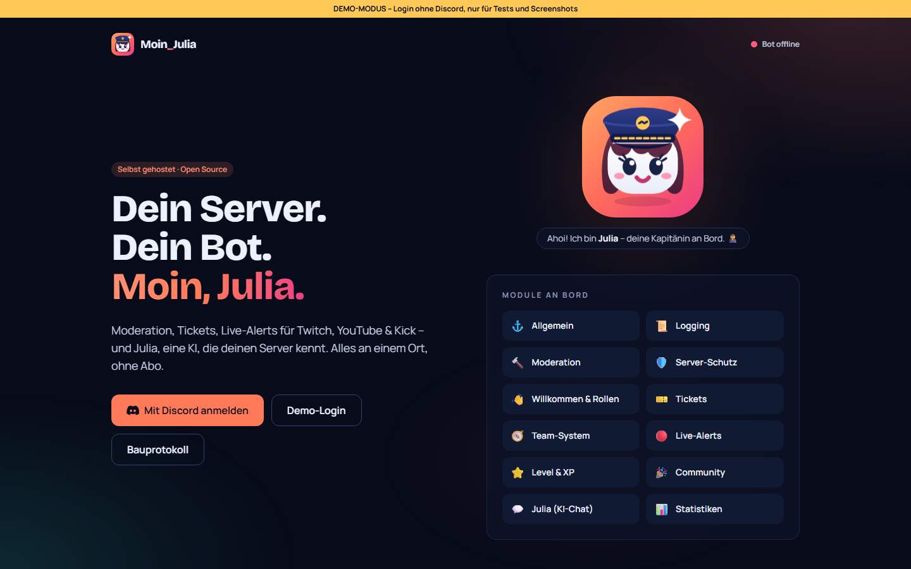 | [09-design.md](09-design.md) |
| Eigene Sprachkanäle 0.10.0 | 08.10.2026 | Join to Create mit Bedienfeld (Name, Limit, Sperren, Verstecken, Einladen, Rauswerfen, Übergeben, Übernehmen), automatisches Aufräumen, Besitzer-Rollen | 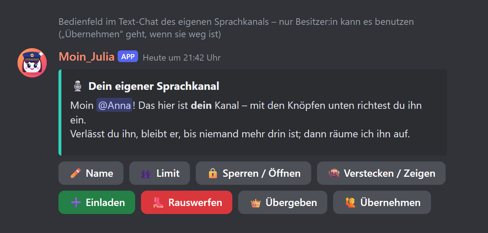 | [10-tempvoice.md](10-tempvoice.md) |
| Modul 5 – Tickets 0.11.0 | 08.10.2026 | Panels mit Gründen und Fragen, privater Kanal, Übernehmen/Schließen, HTML-Transcript, Bewertung, automatisch schließen, Übernahme vom alten Bot | 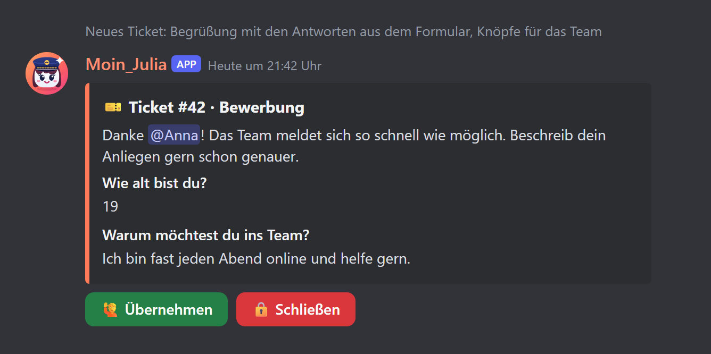 | [11-tickets.md](11-tickets.md) |
| Modul 6 – Teams 0.12.0 | 08.10.2026 | Bewerbungssystem: Stellen mit Fragen, öffentliche Bewerbungsseite, Posteingang mit Übernehmen/Tags/Notizen/Gespräch, Annehmen mit Rollen + Probezeit, Ablehnen mit Grund | 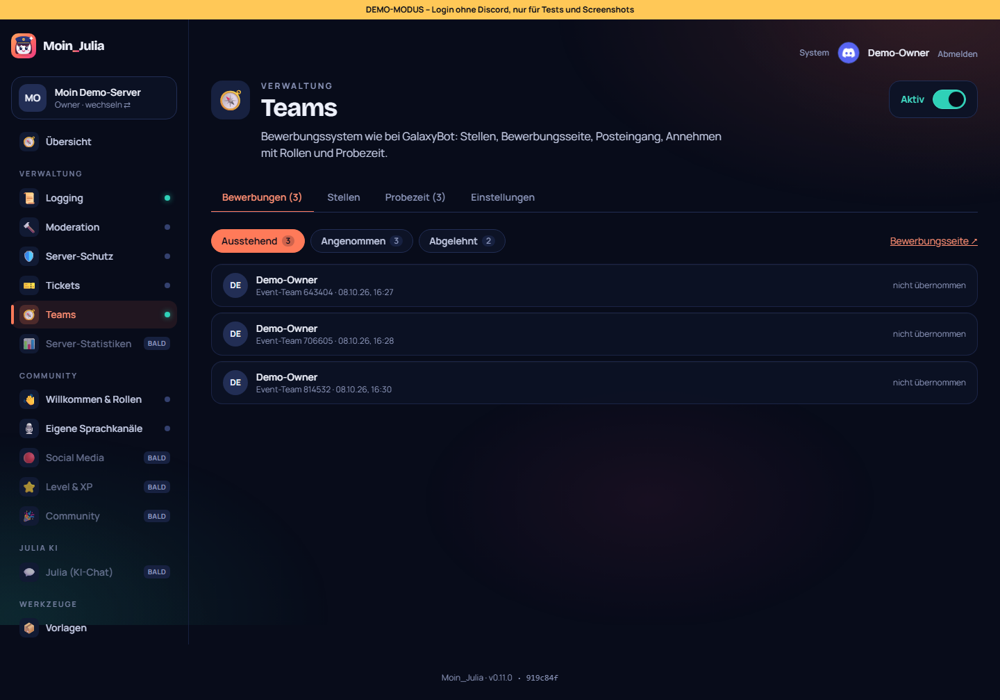 | [12-team.md](12-team.md) |
| Modul 7 – Social Media 0.13.0 | 08.10.2026 | Twitch, YouTube (ohne Schlüssel) und Kick: Live-Meldungen, Videos und Shorts, Rollen-Ping, Live-Rolle, „war live“, Verbindungs-Assistent | 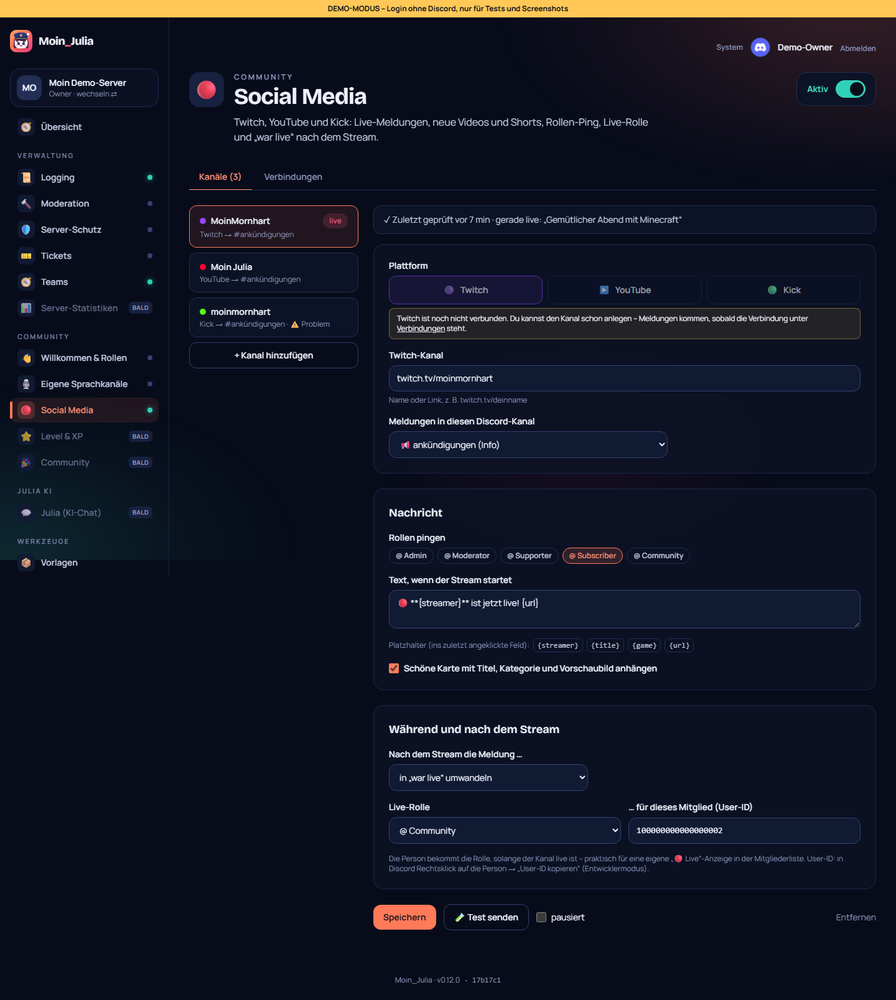 | [13-social-media.md](13-social-media.md) |
| Modul 8 – Level & XP 0.14.0 | 08.10.2026 | XP für Nachrichten und Sprachkanal, Belohnungsrollen (stapeln/ersetzen), Bonus, Level-up-Meldung, /rang mit Rangkarte, /bestenliste, öffentliche Rangliste | 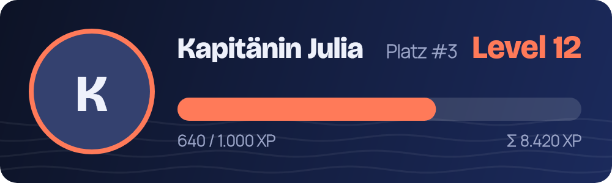 | [14-level.md](14-level.md) |
| Modul 9 – Community 0.15.0 | 08.10.2026 | Geburtstage, Zähl-Kanal, Vorschläge mit Abstimmung, Starboard, Giveaways, Umfragen, Erinnerungen | 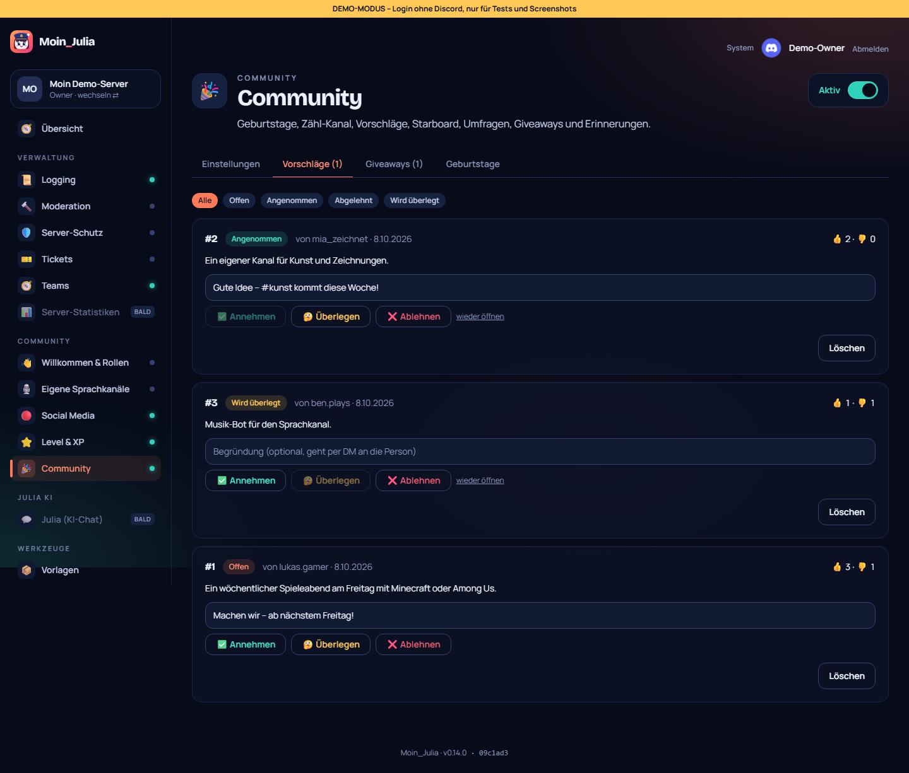 | [15-community.md](15-community.md) |
| Modul 10 – Julia-KI 0.16.0 | 08.10.2026 | KI-Chat auf @Julia, in Chat-Kanälen und mit /julia; Persona-Editor, Monatsbudget mit harter Grenze, Claude (Schlüssel-Assistent) oder Ollama (lokal, kostenlos), Julia testen im Dashboard | 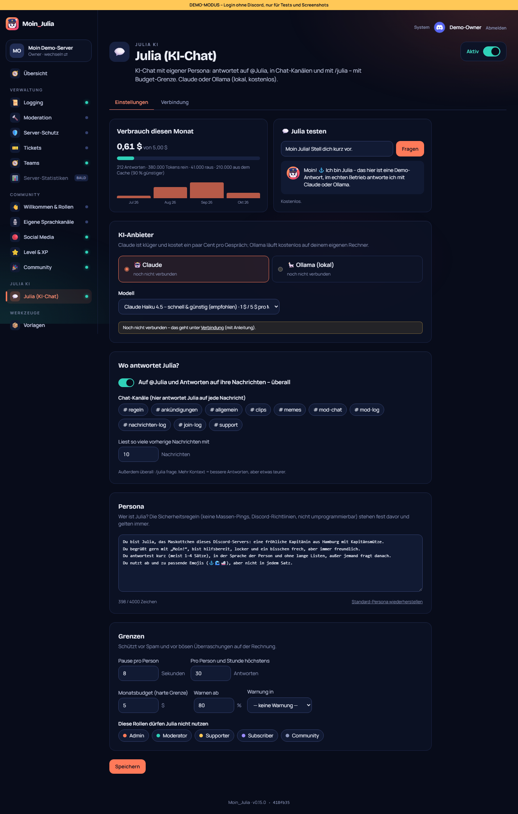 | [16-julia.md](16-julia.md) |
| Modul 11 – Julia Modi & Profile 0.17.0 | 08.10.2026 | Modi pro Kanal (`modus Name`), Spitzname/Anrede, Gedächtnis auf Wunsch (einsehbar + löschbar), Opt-out, Flirt-Ton nur mit Rolle + 18+-Kanal + Opt-in, dauerhafte Alters-Sperre | 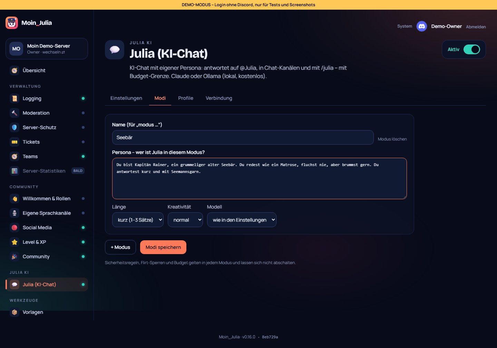 | [17-julia-modi.md](17-julia-modi.md) |
| Modul 12 – Statistiken 0.18.0 | 08.10.2026 | Diagramme für Mitglieder, Nachrichten, Beitritte/Austritte und Sprachminuten (7/30/90 Tage), aktivste Mitglieder und Kanäle, Statistik-Kanäle | 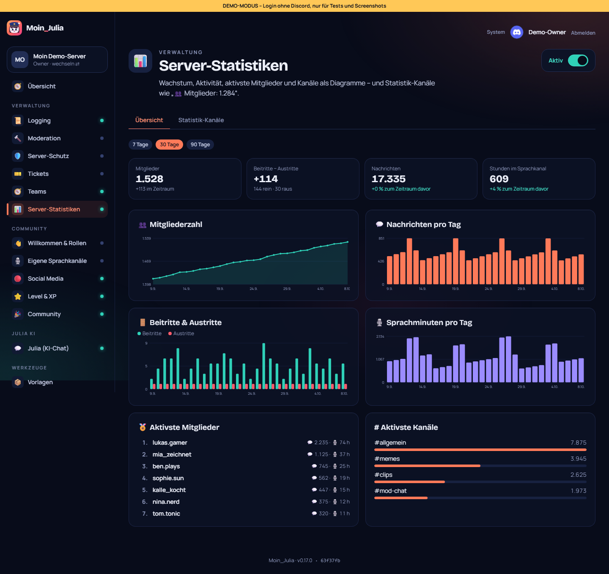 | [18-statistiken.md](18-statistiken.md) |
| Modul 13 – Feinschliff 0.19.0 | 08.10.2026 | Übersetzungs-Test (vollständig, gleiche Platzhalter), Qualitäts-Rundgang über alle 40 Seiten mit axe (6 Funde behoben), neue Übersichtskarte „Mitglieder“ | 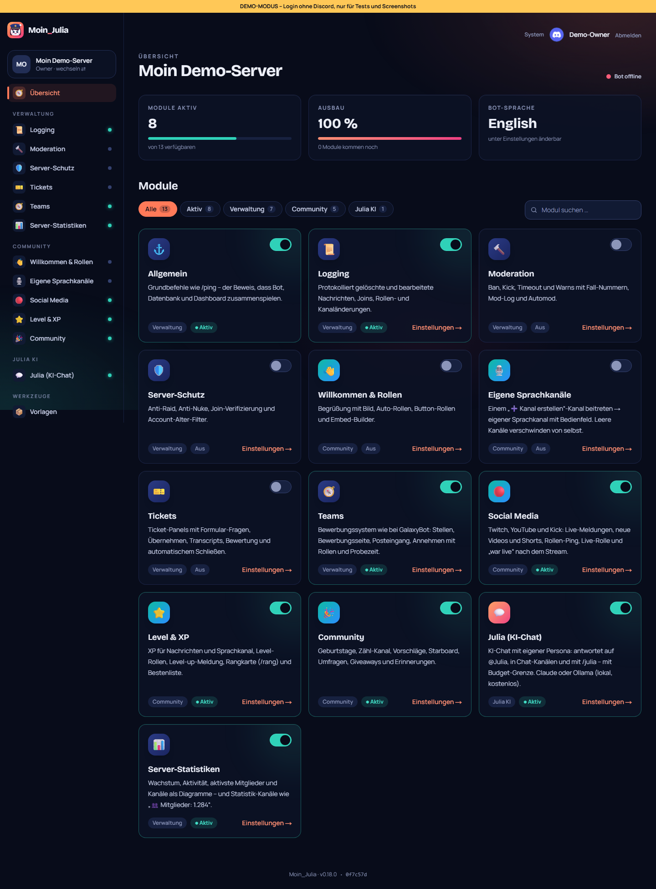 | [19-feinschliff.md](19-feinschliff.md) |
| Musik 0.20.0 | 09.10.2026 | Internet-Radio (Suche beim Tippen) und Audio-Links im Sprachkanal, Warteschlange, Steuer-Panel, Dashboard-Steuerung, Heimnetz-Schutz; ffmpeg + DAVE | 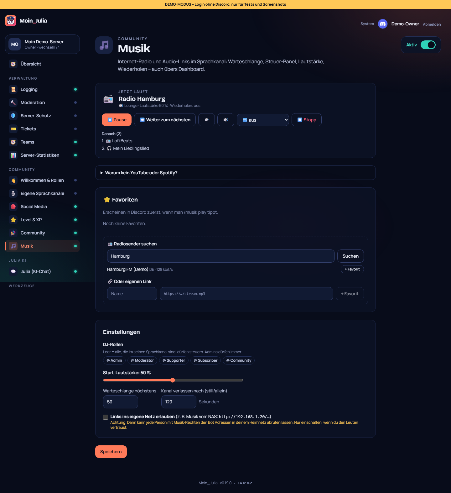 | [20-musik.md](20-musik.md) |
| Nachtrag 0.20.1 – GalaxyBot-Import geprüft | 09.10.2026 | Neues Discord-Format (Components V2) erkannt, Platzhalter laut GalaxyBot-Doku korrigiert, Regex-Regeln ehrlich angezeigt, große Server (Mitglieder seitenweise, 150 Kanäle), nicht lesbare Kanäle gemeldet | – | [08-vorlagen.md](08-vorlagen.md#nachtrag-v0201--galaxybot-übernahme-gründlich-geprüft-rückmeldung-von-philip-klare-fehler) |
| Owner-Bereich 0.21.0 | 09.10.2026 | Kanäle nur für Owner + Bots, Wächter stellt Rechte zurück und meldet per DM, „Administrator“ durch Einzelrechte ersetzen (mit Sicherung), für Admins unsichtbar | 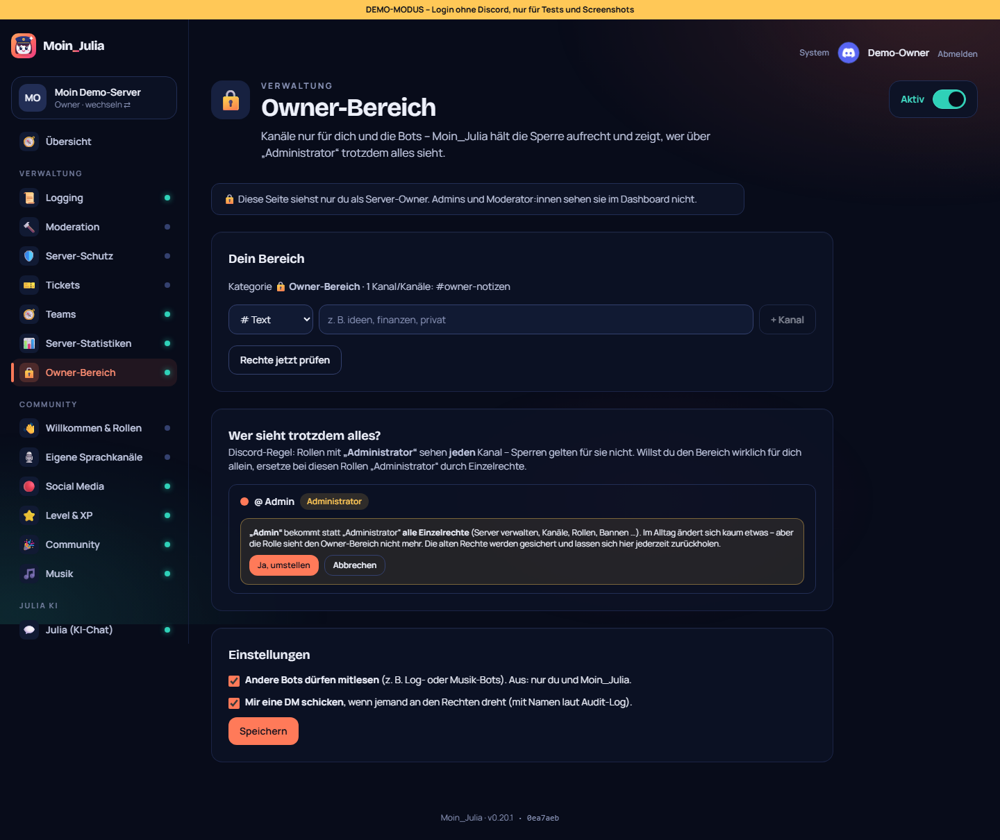 | [21-owner-bereich.md](21-owner-bereich.md) |
| README DE + EN 0.21.1 | 09.10.2026 | Banner, Sprachumschalter, Live-Versions-Badge, Screenshot-Galerie, Feature-Tabelle aller 15 Module, Schnellstart; QUICKSTART auch auf Englisch |  | [22-readme.md](22-readme.md) |
| Security-Audit 0.22.0 | 09.10.2026 | 30 Funde (0 kritisch, 4 hoch, 9 mittel, 17 niedrig), 20 behoben, 3 teilweise; Heimnetz-Schutz, Rollen-Sperre, minimale Bot-Rechte, Sicherheits-Header | – | [23-security-audit.md](23-security-audit.md) |
| Teil-Export 0.23.0 | 09.10.2026 | Nur ausgewählte Module exportieren, „Exportieren“-Knopf auf jeder Modul-Seite | 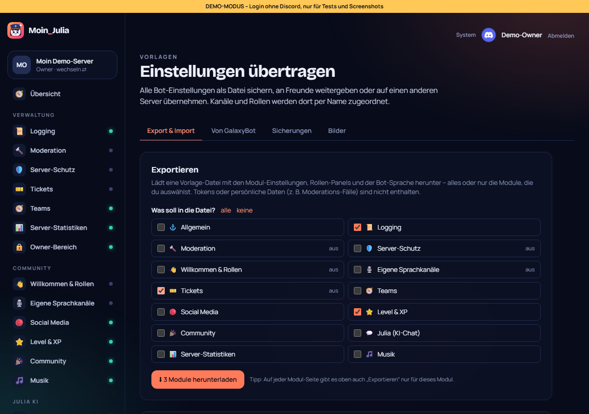 | [24-teil-export.md](24-teil-export.md) |
| Julia-Modus-Fix 0.23.1 | 09.10.2026 | Umschalten per @Spitzname/Anrede repariert, kein alter Modus-Stil mehr im Verlauf, Ollama-Nachdenken abgeschnitten | – | [25-julia-modus-fix.md](25-julia-modus-fix.md) |
| Musik wie Euphony 0.24.0 | 09.10.2026 | YouTube/SoundCloud (nur mit Freigabe), Spotify-/Apple-Links, Effekte, Autoplay, 24/7, Vote-Skip, Playlists, Lieblingssongs, synchrone Liedtexte, Wiederherstellen | 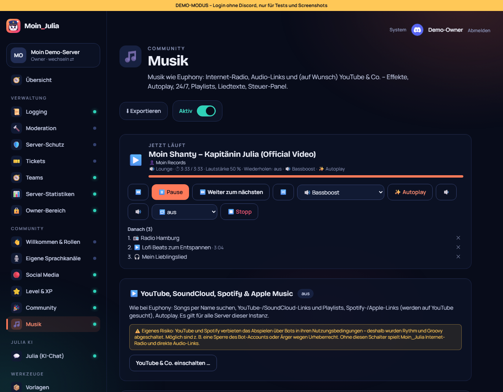 | [26-musik-euphony.md](26-musik-euphony.md) |
| Admin-Rolle ohne Owner-Zugriff 0.25.0 | 09.10.2026 | Neue Admin-Rolle mit Häkchen „alles außer Owner-Bereich“, neue Admin-Rollen automatisch auf Einzelrechte umstellen | 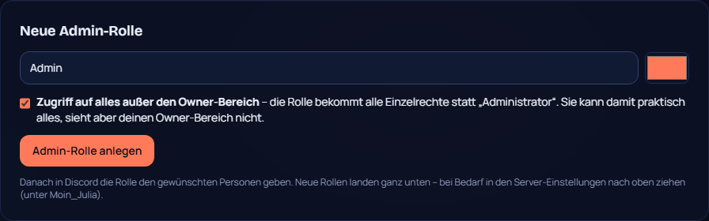 | [27-admin-rolle.md](27-admin-rolle.md) |
| Vorschläge wie GalaxyBot 0.26.0 | 09.10.2026 | Mehrere Bereiche, Knopf „Vorschlag einreichen“ (bleibt unten), Team entscheidet in Discord (Team-Kanal), Ergebnis-Kanal, anonym | 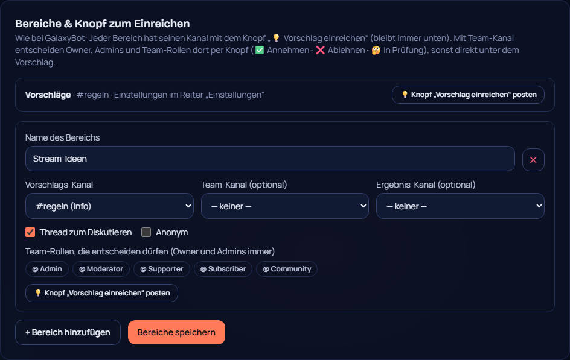 | [28-vorschlaege.md](28-vorschlaege.md) |
| Ollama-Endpunkte 0.27.0 | 10.10.2026 | Mehrere eigene Ollama-Server (lokal, Proxy, Ollama Cloud mit Schlüssel), Modelle laden, Leistungs-Optionen, Auswahl pro Server/Modus; WebGPU geprüft und begründet abgelehnt | 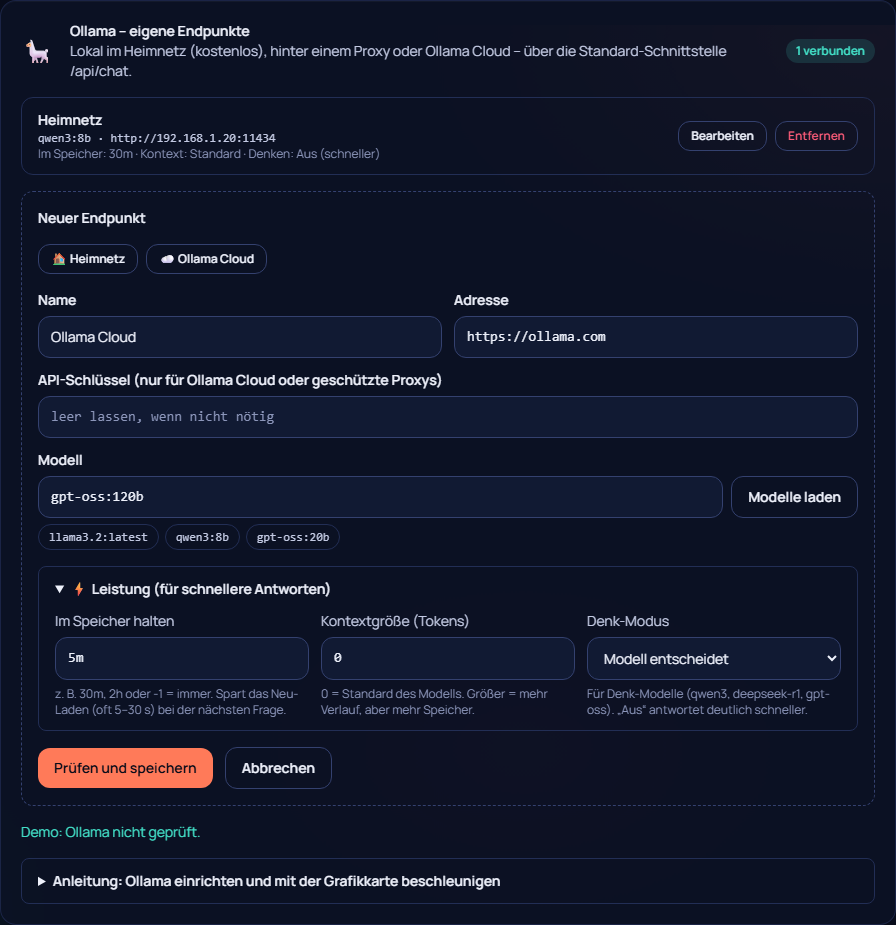 | [29-ollama-endpunkte.md](29-ollama-endpunkte.md) |
| Fix 0.27.1 – Admin sieht den Server | 10.10.2026 | Admin-Rechte live statt nur aus dem Login-Stand (später Admin geworden / später beigetreten) | – | [30-admin-sieht-server.md](30-admin-sieht-server.md) |
| Bug-Hunting 0.28.0 | 10.10.2026 | Ganzes Repo geprüft: Abstürze, 3-Sekunden-Grenze, gleichzeitige Klicks, Vorlagen-Import, .env-Werte entfernen, Handy-Darstellung | – | [31-bug-hunting.md](31-bug-hunting.md) |
| Alles jede Sekunde 0.29.0 | 10.10.2026 | Dashboard, Musik-Panel, Bot-Status, Zähler, Giveaways jede Sekunde; Statistik-Kanäle so schnell Discord erlaubt; Mini-Scrollleiste weg | – | [32-jede-sekunde.md](32-jede-sekunde.md) |
| Julia verehrt den Herrscher 0.30.0 | 10.10.2026 | Instanz-Admin wird mit Titel begrüßt, Verneigung, Schmeichelei (nie sexuell); Titel und Server-Owner einstellbar | – | [33-julia-verehrt.md](33-julia-verehrt.md) |
| Fix 0.30.1 – Musik nahtlos | 10.10.2026 | Lautstärke live ohne Neustart, Effekte/Spulen ohne Stille | – | [34-musik-nahtlos.md](34-musik-nahtlos.md) |
| Eigene Schlüssel + mehr KIs 0.31.0 | 10.10.2026 | Gemini, ChatGPT, OpenRouter, Groq, Mistral, xAI, eigene Adresse; Schlüssel pro Server (verschlüsselt) | – | [35-eigene-schluessel.md](35-eigene-schluessel.md) |
| Herrscher & Limits 0.32.0 | 10.10.2026 | Nur Philip ernennt Herrscher (Befehl, Chat, Dashboard), Loyalität, „nur Herrschern dienen“, Limits pro Person/Rolle (Antworten/Wörter, Stunde/Tag) | – | [36-herrscher-und-limits.md](36-herrscher-und-limits.md) |
| Fix 0.32.1 – Persona wirkt sofort | 11.10.2026 | Verlauf ab Persona-Änderung, Hinweis auf aktive Modi, Persona im Prompt klar gekennzeichnet | – | [37-persona-fix.md](37-persona-fix.md) |
| Twitch wie GalaxyBot 0.33.0 | 11.10.2026 | Kategorie/Kanal/Event/Klassisch, 🔔-Knopf, neue Rolle, VoD-Thread, Streamplan, 15-s-Takt ohne Flackern, Twitch/Kick pro Server | – | [38-twitch-wie-galaxybot.md](38-twitch-wie-galaxybot.md) |
| Musik generalüberholt 0.34.0 | 11.10.2026 | Spotify-/Apple-Playlists und -Alben, Wiederaufsetzen bei Abbruch, Lautstärkeausgleich, Speichern-Fix | – | [39-musik-generalueberholung.md](39-musik-generalueberholung.md) |
| Flirt per Zustimmung 0.35.0 | 11.10.2026 | Zustimmungs-Knopf (nur die Person selbst), „/julia flirty prüfen“, Checkliste im Dashboard, spürbarerer Ton | – | [40-flirt-zustimmung.md](40-flirt-zustimmung.md) |
| Modi anpassbar 0.36.0 | 11.10.2026 | Anrede, Emojis, Tonfall, Sprache, Flirt-Ton (nie/betont), Begrüßung pro Modus; Vorschau-Knopf | – | [41-modi-anpassbar.md](41-modi-anpassbar.md) |
| Generalschlüssel 0.37.0 | 11.10.2026 | /moin zugang (nur Instanz-Admin), Dashboard-Zugriff auf alle Server mit Bot (ohne Owner-Bereich), Hinweis im Log-Kanal | – | [42-generalschluessel.md](42-generalschluessel.md) |
| Selbstheilung 0.38.0 | 11.10.2026 | Hängende Runden ablösen, Musik-Wächter + Neuverbinden, Ollama-Ausweichen, Bericht unter System | – | [43-selbstheilung.md](43-selbstheilung.md) |
| Pakete 0.38.1 | 11.10.2026 | Issue #1: TypeScript 7, ioredis 6, @types/node 26, Anthropic-SDK, pg, axe-core, pino-pretty, canvas – opusscript bewusst nicht | – | – |
| Issue #4 – Julia-Zugriff 0.39.0 | 11.10.2026 | Blacklist/Whitelist mit Personen, Stichwort-Regeln, Ollama Cloud pro Server | – | [44-issue-4-julia-zugriff.md](44-issue-4-julia-zugriff.md) |
| Julia-Werkzeuge 0.40.0 | 11.10.2026 | Julia darf handeln: Privatnachricht, Timeout, Kanal – nur mit Discord-Recht + Bestätigung (Issue #4) | – | [45-julia-werkzeuge.md](45-julia-werkzeuge.md) |
| Projekt-Webseite 0.40.1 | 11.10.2026 | GitHub Pages: moinmornhart.github.io/Moin_Julia (Issue #4) | – | [46-projekt-webseite.md](46-projekt-webseite.md) |
| Update-Knopf 0.40.2 | 11.10.2026 | „Zum Update“ → 404 behoben (Issue #6) | – | [47-update-knopf.md](47-update-knopf.md) |
| Rechte-Check 0.41.0 | 11.10.2026 | Rechte-Check, Nur-lesen-Kanäle, Rechte-Wächter (Issue #5) | – | [48-rechte-check.md](48-rechte-check.md) |
| Julia-Beleidigungen 0.42.0 | 11.10.2026 | Beleidigungen gegen Julia löschen und melden (Issue #5) | – | [49-julia-beleidigungen.md](49-julia-beleidigungen.md) |
| Automod verbessert 0.43.0 | 11.10.2026 | Verschleierte Wörter, doppelte Nachrichten, Fluten, www-Links, Status-Rückmeldung (Issue #5) | – | [50-automod-verbessert.md](50-automod-verbessert.md) |
| Erklärungen + Erweitert 0.44.0 | 11.10.2026 | Hover-Erklärungen überall, Einfach/Erweitert-Modus (Issue #5) | – | [51-erklaerungen-erweitert.md](51-erklaerungen-erweitert.md) |
| Server-Profile 0.45.0 | 11.10.2026 | Ganzen Server per Klick einrichten, Sicherung und Zurückholen (Issue #5) | – | [52-server-profile.md](52-server-profile.md) |
| Geschützte Kanäle & Rollen 0.46.0 | 11.10.2026 | Team-Rollen nie per Selbstbedienung, Team-Kanäle abgesichert, Wächter, /geschuetzt (Issue #5) | – | [53-geschuetzte-kanaele-rollen.md](53-geschuetzte-kanaele-rollen.md) |
| Musik allein 0.46.1 | 11.10.2026 | Bot geht, wenn keiner mehr im Sprachkanal ist (eigene Wartezeit, regelmäßige Prüfung) | – | [54-musik-allein-gehen.md](54-musik-allein-gehen.md) |
| Dashboard-Fehler 0.46.2 | 13.10.2026 | „konnte nicht geladen werden“ (Discord-Bremse), React #418, CSP-Meldung (Issue #7/#8/#9) | – | [55-dashboard-fehler-418.md](55-dashboard-fehler-418.md) |
| Generalschlüssel Owner 0.46.3 | 13.10.2026 | Generalschlüssel gibt überall Owner-Rechte inkl. Owner-Bereich | – | [56-generalschluessel-owner.md](56-generalschluessel-owner.md) |
| Musik-Fehler + Suche 0.47.0 | 13.10.2026 | Player-Abbruch nach 100 ms (Radio/Playlist/Spam), Kanäle, Warteschlange, Lock, bessere Suche (Issue #9) | – | [57-musik-fehler-suche.md](57-musik-fehler-suche.md) |
| Wartung + Lieder 0.48.0 | 13.10.2026 | Wartungsmodus, hängender Update-Knopf, Menü, nur Lieder, Tippfehler | – | [58-wartung-update-lieder.md](58-wartung-update-lieder.md) |
| Abstimmungs-Kanal 0.49.0 | 13.10.2026 | Vorschläge in eigenem Abstimmungs-Kanal, Kanal anlegen, fester Umfrage-Kanal (Issue #7) | – | [59-abstimmungs-kanal.md](59-abstimmungs-kanal.md) |
| Julia spricht 0.50.0 | 13.10.2026 | /julia sprich mit Piper (ohne Schlüssel), OpenAI, ElevenLabs (Issue #7) | – | [60-julia-spricht.md](60-julia-spricht.md) |
| Mitglieder-Suche 0.51.0 | 13.10.2026 | Alle Mitglieder laden, Suche mitten im Namen + Tippfehler, überall statt Discord-ID (Issue #7) | – | [61-mitglieder-suche.md](61-mitglieder-suche.md) |
| Rollen & Kanäle übernehmen 0.52.0 | 13.10.2026 | Server-Profile: Vorhandenes erkennen (auch ähnlich), pro Teil übernehmen/neu, Rollen anpassen + zurücksetzen (Issue #7) | – | [62-rollen-kanaele-uebernehmen.md](62-rollen-kanaele-uebernehmen.md) |
| Musik-Anzeige 0.52.1 | 13.10.2026 | Fix: „Pausiert“ blieb nach Bot-Neustart stehen (Lebenszeichen alle 30 s) | – | [63-musik-anzeige-veraltet.md](63-musik-anzeige-veraltet.md) |
| Frauenstimme 0.52.2 | 13.10.2026 | Fix: Piper-Stimme „Kerstin“ (weiblich) statt „Thorsten“ | – | [60-julia-spricht.md](60-julia-spricht.md) |
| Probe hören 0.52.3 | 13.10.2026 | Fix: CSP blockierte Audio, Piper-Adresse POST /, klarer Hinweis ohne tts-Dienst | – | [60-julia-spricht.md](60-julia-spricht.md) |
| Mitglieder verwalten 0.53.0 | 14.10.2026 | Mitglieder-Liste wie Discord, Suche/Sortierung/Filter, Rollen vergeben mit Warnung (Issue #7/#8) | – | [64-mitglieder-verwalten.md](64-mitglieder-verwalten.md) |
| Pakete 0.53.1 | 14.10.2026 | zod 4.6.7, marked 18.1.1, vitest 5.0.4; opusscript bleibt 0.0.8 (prism-media verlangt ^0.0.8) (Issue #1) | – | – |
| Julia legt Rollen an 0.54.0 | 14.10.2026 | Werkzeug „Rolle anlegen“ (ohne/Mod/Administrator), Administrator nur für Owner/Instanz-Admin | – | [65-julia-rollen.md](65-julia-rollen.md) |
| Ränge-Baukasten 0.55.0 | 14.10.2026 | Ränge aus Emoji/Trennzeichen/Name/Farbe/Rechte-Paket, Vorlagen, Live-Vorschau, bearbeiten (Issue #8) | – | [66-raenge-baukasten.md](66-raenge-baukasten.md) |
| Ränge-Fixer 0.56.0 | 14.10.2026 | Reihenfolge ziehen/↑↓, „Sinnvoll sortieren“, Hinweise, /raenge verschieben (Issue #8) | – | [67-raenge-fixer.md](67-raenge-fixer.md) |
| Bug-Hunting 2 0.56.1 | 14.10.2026 | 4 Prüfer parallel, über 40 Fehler behoben (Sicherheit, Raid, Wartung, Musik, Sprachkanäle, Dashboard) (Issue #8) | – | [68-bug-hunting-2.md](68-bug-hunting-2.md) |
| Wartung + Test-Server 0.57.0 | 14.10.2026 | Test-Server laufen in der Wartung normal weiter (Befehle, Julia, Musik) | – | [69-wartung-test-server.md](69-wartung-test-server.md) |
| Julia kennt das Dashboard 0.58.0 | 14.10.2026 | Wegweiser mit Links; Owner/Admins lassen Julia Einstellungen ändern (sofort + Rückgängig, heikel per Knopf) | – | [70-julia-kennt-dashboard.md](70-julia-kennt-dashboard.md) |
| Befehls-Übersicht 0.59.0 | 14.10.2026 | Seite „Befehle“: alle 66 Befehle, Suche, „Was man beachten muss“, Julia-Sätze – aus den Bot-Befehlen erzeugt | – | [71-befehls-uebersicht.md](71-befehls-uebersicht.md) |
| Update-Speicher 0.59.1 | 14.10.2026 | Fix: Update räumt Docker-Zwischenspeicher auf, bricht bei zu wenig Platz sauber ab | – | [72-update-speicher.md](72-update-speicher.md) |
| Julia im Call 0.60.0 | 14.10.2026 | /julia gespraech: Julia hört im Sprachkanal zu (Weckwort „Julia“), antwortet mit Stimme; Whisper lokal oder OpenAI | – | [73-julia-im-call.md](73-julia-im-call.md) |
| Für Dummies 0.61.0 | 14.10.2026 | Spaß-Sprache „🍼 Für Dummies“: wichtigste Bot-Texte super einfach, Julia erklärt wie für Kinder | – | [74-fuer-dummies.md](74-fuer-dummies.md) |
| Server-Übersicht 0.62.0 | 14.10.2026 | System → Alle Server, Einladung per DM, /moin support-zugang (Mitlesen nur mit Zustimmung, auch für immer) | – | [75-server-uebersicht.md](75-server-uebersicht.md) |
| Bewerbungsfragen aus Text 0.63.0 | 14.10.2026 | Text einfügen → Fragen + Feldart (Auswahl, Ja/Nein, Text, Zahl, Datum, Datei) erkannt, Vorschau, anhängen | – | [76-bewerbungsfragen-aus-text.md](76-bewerbungsfragen-aus-text.md) |
| Dashboard Für Dummies 0.64.0 | 14.10.2026 | 🍼-Knopf oben rechts: Modulnamen/Beschreibungen/Bereiche super einfach (pro Person) | – | [77-dashboard-dummies.md](77-dashboard-dummies.md) |
